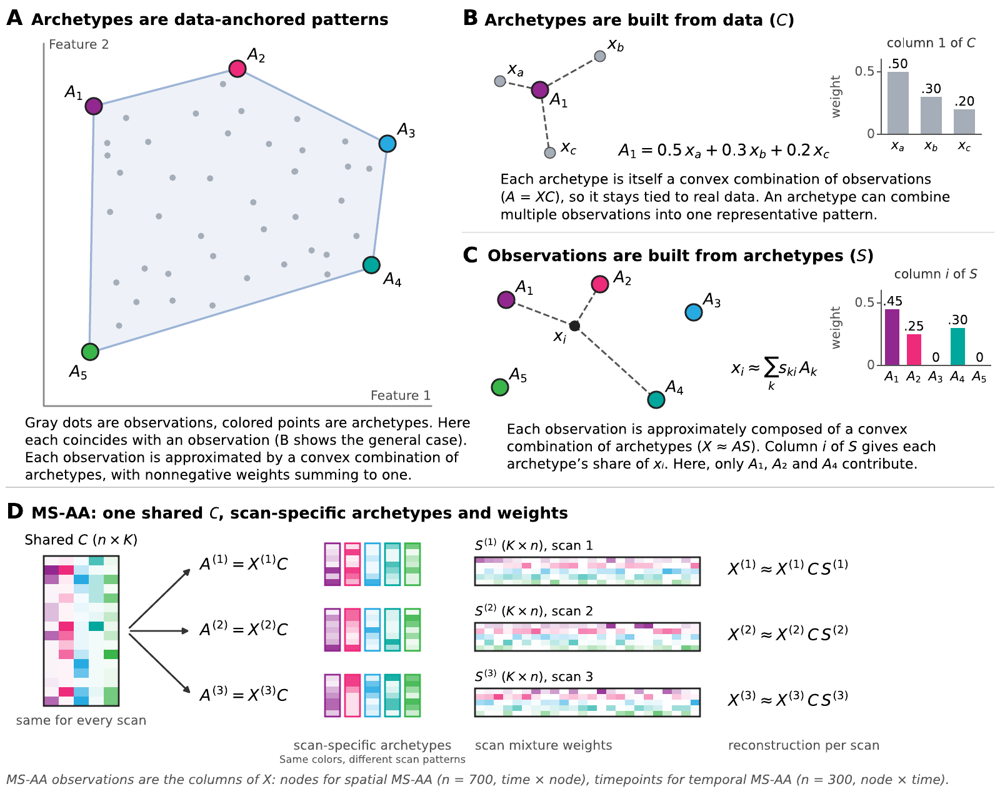
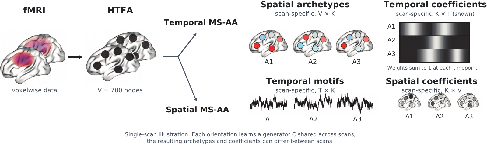

# Sparse Distributed Archetypal Motifs Capture Shared Network Structure in Naturalistic fMRI

[](https://www.python.org/downloads/)
[](https://doi.org/10.5281/zenodo.24358585)
[](LICENSE)

Code for Oliver, Shepherd, Stone & Owen, *Sparse Distributed Archetypal Motifs Capture Shared Network
Structure in Naturalistic fMRI* (Network Neuroscience, under revision): multi-subject archetypal
analysis (MS-AA), from the two HTFA inputs to the figures and source tables in the paper and supplement.

<p align="center">
  <br>
  <sub><b>Figure 1.</b> Multisubject archetypal analysis (MS-AA): a shared generator <i>C</i> defines data-anchored archetypes across scans with scan-specific archetypes <i>A</i><sup>(<i>s</i>)</sup> and mixing weights <i>S</i><sup>(<i>s</i>)</sup>.</sub>
</p>

<p align="center">
  <br>
  <sub><b>Figure 2.</b> Spatial and temporal MS-AA orientations applied to 700-node HTFA fMRI data.</sub>
</p>

## Data

The analyses use the Pieman naturalistic-listening fMRI dataset of Simony et al. (2016), in the
700-node hierarchical topographic factor analysis (HTFA) representation released by Owen & Manning:

**[`pieman2_htfa.pkl` on Zenodo, DOI 10.5281/zenodo.24358585](https://doi.org/10.5281/zenodo.24358585)** (CC BY 4.0)

The file holds, for every scan, the time-by-node HTFA weights (700 nodes) plus the node centers
and widths. Conditions: intact story, word-scrambled story and rest (36 scans each; 108 scans from
87 participants), and paragraph-scrambled story (17 scans, used only in the four-condition
sensitivity analysis). `scripts/pkl_to_mat.py` converts it to the two inputs the pipeline reads;
see [data/README.md](data/README.md).

## Setup

```bash
uv sync --frozen
# download pieman2_htfa.pkl from Zenodo (DOI 10.5281/zenodo.24358585), then write the two inputs to data/input/:
uv run make data PKL=/path/to/pieman2_htfa.pkl   # = uv run python scripts/pkl_to_mat.py /path/to/pieman2_htfa.pkl
uv run make check      # low-rank decoding parity test, then the inputs can be read
uv run make atlas      # Schaefer-1000 / Yeo-7 atlas into data/reference/ (needs internet)
uv run make smoke      # small end-to-end run (4 participants, K = 5), seconds
```

`make atlas` downloads the atlas with nilearn, so on a cluster whose compute nodes are offline,
run it once on a login node before submitting batch jobs.

Without uv (for example on a cluster), install the same pinned versions into a Python 3.12
environment with `pip install -r requirements.txt` (exported from `uv.lock` with
`uv export --frozen --no-hashes --no-emit-project -o requirements.txt`; regenerate it after changing
dependencies), activate it, and run the same targets with plain `make` (for example `make check`).
The package is not installed in either mode: every script and notebook puts `src/` on `sys.path`
itself, so `msaa_pipeline` needs no `pip install -e .` and no `PYTHONPATH`.

## Reproduce

```bash
uv run make results                      # every fit, decode and held-out run (very large)
uv run make figures OUT=figure_bundle    # every figure + source table, from those results
```

`docs/REPRODUCE.md` lists which step makes each result, which figure uses it, and how to run a
subset. `make figures ROOT=/path/to/results` draws from results kept outside the repo.

Local versus cluster scale: `make data`, `check`, `test`, `atlas` and `smoke` run in seconds to
minutes on a laptop. `make results` is cluster scale (weeks of CPU time on one machine).
`make figures` takes minutes but needs finished results: it draws from the result folders
`make results` writes, not from `paper/source_tables/`. To check a number without rerunning
anything, read the committed source tables directly (next section).

## Layout

```text
src/msaa_pipeline/    fitting, decoding, participant-held-out top-m (used by every analysis)
helpers/              the MS-AA implementation (MultiSubject_AA.py, FurthestSum)
hypertools/           hypertools normalize(), used by the PCA-benchmark, simulation and leave-one-
                      condition-out notebooks (the pipeline applies the same z-score itself; see
                      src/msaa_pipeline/data.py)
tests/                parity check of the low-rank decoding path (make test)
scripts/              run_parallel.py (fit/decode/held-out driver), build_figures.py, input checks,
                      atlas fetch, the frozen FurthestSum picks
analysis/             the analyses behind the figures, in pipeline order (see analysis/README.md)
paper/                figure notebooks/scripts that only draw, source tables, final_figures/ (the published figures)
configs/              frozen FurthestSum picks, held-out outer-split seeds, node -> Yeo-7 table, profiles
data/                 input/ (the two HTFA .mat files) and reference/ (atlas); not committed
```

The HTFA inputs themselves (raw fMRI to HTFA) are made outside this repository.

## Final figures and source tables

`paper/final_figures/` holds every main and supplementary figure exactly as published (EPS + PDF,
manuscript numbering, including the Figure 1-2 schematics).


`paper/source_tables/` holds the tables behind the paper's data figures, with a README mapping each
file to its figure (and listing the few panels without a separate table).

Main Figs. 1–2 are conceptual schematics; figure numbers in this repository (file names, docs, build steps) follow the figure-bundle numbering: Fig 2 = main Fig 3, Fig 3 = main Fig 4, Fig 4A/B = main Fig 5A/B, Fig 4C = main Fig 6A, Fig 4D = main Fig 6B, Fig 5 = main Fig 7, Fig 6/Fig 8 = main Fig 8. Supplementary numbers are unchanged.

## License

MIT; see `LICENSE`. The vendored `hypertools/` folder is from hypertools (Contextual Dynamics
Laboratory) and keeps its own MIT license in `hypertools/LICENSE`; `hypertools/srm.py` keeps its
Apache-2.0 header (Intel Corporation). `helpers/MultiSubject_AA.py` adapts the multisubject AA
implementation of Hinrich et al. (2016), doi:10.1109/JSTSP.2016.2595103.
